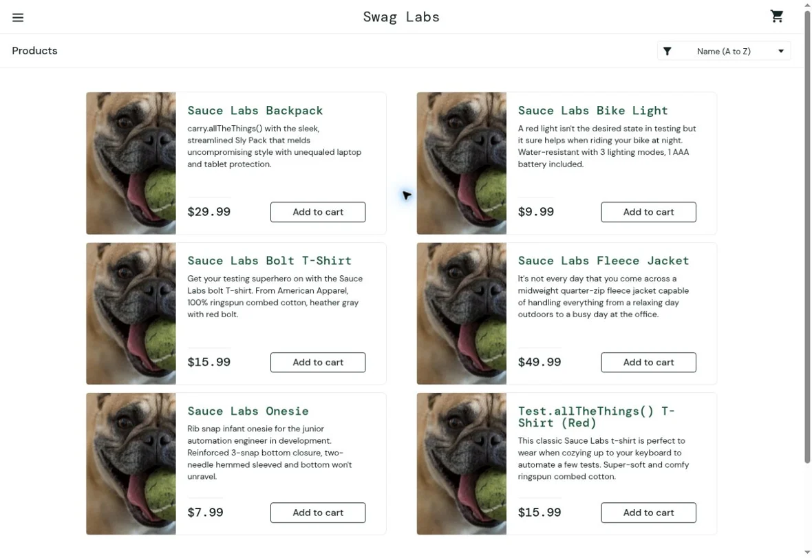

# SD-01. В каталоге problem_user всем товарам назначено одно фото

| Поле | Значение |
|---|---|
| Сервис | [SauceDemo](https://www.saucedemo.com/) |
| Раздел | Каталог Products, `/inventory.html` |
| Окружение | Chromium, Linux, 9 ноября 2026 года |
| Связанный кейс | [TC-05](test-cases.md#tc-05-изображения-каталога-в-профиле-problem_user) |
| Серьёзность | Средняя. Товар невозможно определить по фото, названия и цены доступны. |
| Приоритет | Средний |
| Статус | Воспроизведён на учебном профиле |

## Шаги воспроизведения

1. Выйти из текущего профиля через меню Logout.
2. Ввести `problem_user` и общий пароль, опубликованный на странице входа.
3. Нажать Login.
4. Сравнить фотографии в карточках Sauce Labs Backpack, Sauce Labs Bike Light и Sauce Labs Bolt T-Shirt.

**Ожидаемый результат.** В каждой карточке отображается фото соответствующего товара, как в профиле `standard_user`.

**Фактический результат.** На всех шести карточках одна и та же фотография собаки. Атрибут `src` у всех шести элементов указывает на `/assets/sl-404-Cq1a9k9X.jpg`. В профиле `standard_user` у тех же карточек шесть разных источников изображений.

