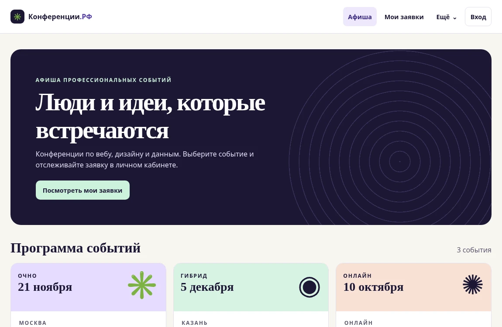

# Практическая работа 3.2. Анализ HTTP-запроса и ответа

Объект проверки — стартовая страница учебного портала «Конференции.РФ» из МДК 09.01. Портал запущен локально на Python SimpleHTTP. Данные сняты в Chromium через Chrome DevTools Protocol. Использованы события `Network.requestWillBeSent`, `Network.requestWillBeSentExtraInfo`, `Network.responseReceived` и команда `Network.getResponseBody`.

## Запрос документа

| Поле | Наблюдение |
|---|---|
| URL | `http://127.0.0.1:8913/10-user-interface/index.html` |
| Метод | `GET` |
| Host | `127.0.0.1:8913` |
| Accept | `text/html,application/xhtml+xml,application/xml;q=0.9,…` |
| User-Agent | `HeadlessChrome/156.0.8078.79` в полной строке UA |
| Sec-Fetch-Dest | `document` |
| Sec-Fetch-Mode | `navigate` |
| Тело | Отсутствует. В записи запроса `hasPostData: false`. |

`GET` запрашивает ресурс. `Accept` перечисляет типы содержимого, которые готов принять браузер, а `Sec-Fetch-Dest: document` показывает, что запрашивается документ для навигации.

## Ответ сервера

| Поле | Наблюдение |
|---|---|
| Протокол ответа | HTTP/1.0 |
| Статус | `200 OK` |
| Content-Type | `text/html` |
| Content-Length | `1523` байта |
| Server | `SimpleHTTP/0.6 Python/3.12.14` |
| Last-Modified | Время последнего изменения файла, см. сетевую запись |

Тело содержит HTML-документ с заголовком страницы, навигацией и ссылками на `styles.css` и `app.js`. Браузер загружает эти ресурсы отдельными запросами. После выполнения JavaScript в блоке `main` появляется афиша, показанная на скриншоте.

[Сетевые события и заголовки](network.json) · [Исходное тело ответа](response.html.txt)

