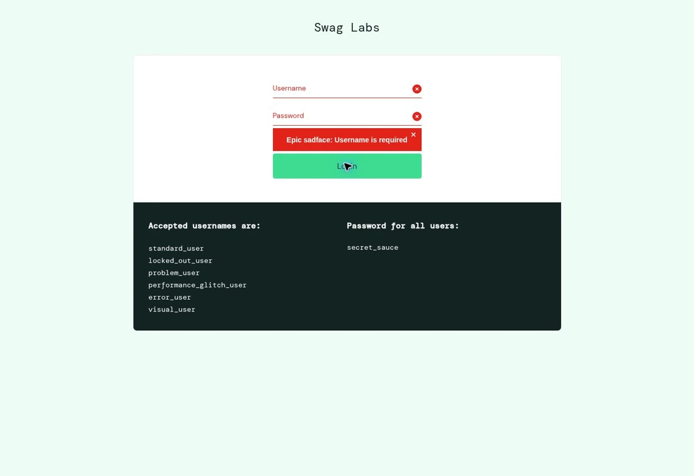

# Практическая работа 3.3. Тестирование формы авторизации

**Объект.** Форма Login на [SauceDemo](https://www.saucedemo.com/), проверена 9 ноября 2026 года в Chromium. В таблице «демопароль» означает общий пароль, опубликованный самим сервисом. Перед серией браузер открыт на странице входа без активной сессии.

Во всех случаях заполнить Username и Password указанными данными, нажать Login и проверить адрес страницы и сообщение формы. Позитивный сценарий выполняется последним, поскольку он создаёт сессию.

| № | Username | Password | Ожидаемый результат | Фактический результат | Итог |
|---|---|---|---|---|---|
| AUTH-01 | Пусто | Пусто | Вход отклонён, логин обязателен | Форма осталась открыта. `Username is required`. | Пройдено |
| AUTH-02 | `standard_user` | Пусто | Вход отклонён, пароль обязателен | Форма осталась открыта. `Password is required`. | Пройдено |
| AUTH-03 | `standard_user` | `wrong-password` | Вход отклонён, сообщение о неверных данных | `Username and password do not match any user in this service`. | Пройдено |
| AUTH-04 | `no_such_test_user` | Демопароль | Вход отклонён, сообщение о неверных данных | Показано то же общее сообщение, что в AUTH-03. | Пройдено |
| AUTH-05 | `locked_out_user` | Демопароль | Заблокированный пользователь остаётся на форме | `Sorry, this user has been locked out.` | Пройдено |
| AUTH-06 | Три пробела | Демопароль | Вход отклонён | Форма осталась открыта, показано сообщение о неверных данных. | Пройдено |
| AUTH-07 | `standard_user` | Три пробела | Вход отклонён | Форма осталась открыта, показано сообщение о неверных данных. | Пройдено |
| AUTH-08 | `standard_user` | Демопароль | Открывается каталог | Открылся `/inventory.html`, виден заголовок Products. | Пройдено |

Форма проверяет пустые поля отдельно. Значение из пробелов отклоняется на проверке пары логин–пароль. Неизвестный логин и неверный пароль приводят к одному сообщению.

